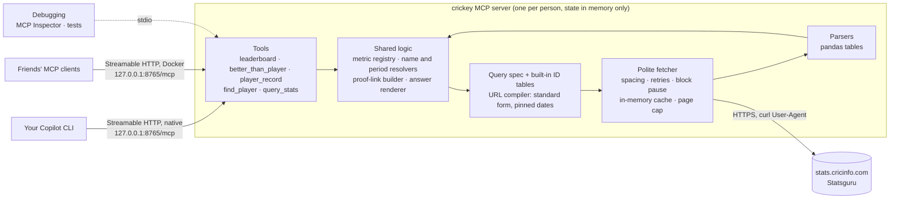

# Plan: `crickey`, an MCP server for Cricinfo Statsguru

## Goal
- Answer cricket statistics questions using only Cricinfo's Statsguru as the data source.
- Every answer includes Cricinfo links that anyone can open to check the numbers and share as proof.
- The golden questions must work. [evals/golden_questions.toml](../evals/golden_questions.toml) is the one place they're listed (D41): each in its general form, with a number that the docs use, and as the eval asks it, with real players filled in.

## Overview
This plan says how to build crickey to meet the goal. It refers to decisions and research instead of repeating them:
- **Decisions:** [decisions.md](decisions.md), referred to by number (D1, D2, …).
- **Research facts:** [research.md](research.md), referred to by section as R1–R17.

## Versions
R15 lists the versions to use (D22).
- `pyproject.toml` sets `requires-python` to R15's Python minor version and, for each dependency, a lower bound at its R15 version (lower where D27 says so) and an upper bound below its next major version.
- Actions are pinned to the commit SHAs of R15's releases.

## Architecture

## Statsguru coverage (`query_stats`)
`query_stats` exposes Statsguru's own basic and advanced forms for every stat type, with Statsguru's field names and values (R4) and its minimum and sort options (R5). Nothing is renamed or regrouped. It accepts checkbox groups and the dropdown filters R2 lists as repeated values, sorted for stable URLs. It also accepts all three result qualifications that Statsguru supports (R2).

## MCP tools (v1)
Five tools (D14), all read-only.
- **Answer tools** return `answer_markdown` plus structured data. The markdown has a short answer, a table, the method and assumptions, labelled pinned links and profile links (D16), the "as of" date and the freshness line (D17). Fielding answers also say that Statsguru's fielding figures leave out run-outs (D35).
- **What a call cost:** every tool result's `_meta`, errors included, has `crickey/statsguru`, with the Statsguru requests the call sent and the pages it read from the cache (D38). Models don't see it; the evals' cost check reads it.
- **Ambiguous names** (players, teams, grounds, trophies) return `needs_clarification` with the candidates. Player candidates list each one's ID, country, span and match count in the requested format, and the text says to call again with `player_id`.
- **Players by ID:** `better_than_player` and `player_record` take the player's name or `player_id`, the ID from `find_player` or a player clarification; players with the same name and country can only be told apart by ID (R7). An ID skips the name search, and the name shown comes from the pages the tool reads anyway (X's results row or player page, R6). If `player_name` clearly names someone else (no surname-like word in common), the ID wins and the assumptions say so. An ID with no record in the format is an error naming the ID and the format; errors by ID name the player only as Statsguru does, or by ID.
- **Descriptions** for answer tools start with example questions, followed by bowling and fielding examples where applicable and, for `player_record`, a split example. The examples are written for models, to show what each tool answers; they don't have to match the golden questions, and the evals show whether they're enough (D13, D41). `better_than_player` and `player_record` then mention `player_id`. `find_player` and `query_stats` start with their own example question.
- **Parameter descriptions:** every top-level parameter has a one-line description of what it takes, with an example where that helps, such as "World Cup" for `trophy` (#66, D13). A period's description shows the forms it takes, such as "last 3 years" and "2000 to 2009" (D42), and says that a tournament goes in `trophy`; `player_name` and `player_id` each say to give one or the other. Defaults and allowed values stay in the schema, not the description, except where a model's renderer may hide them: `query_stats`'s `query` says it needs `class` and `type`, and lists their values (#85, R17). The descriptions add under 10% to the tool definitions (R17).

1. **`leaderboard`** (golden question 1): "Who has the best or fastest …?"
   - Parameters: format, discipline (batting by default, bowling or fielding), metric, period (all time by default, or years, dates or a season), filters by name (team, opposition, host country, continent, ground, trophy, home or away, match result), minimum and top N.
   - Metrics can be Statsguru columns (batting: runs, average, strike rate, hundreds, …; bowling: wickets, bowling average, economy rate, bowling strike rate, five-wicket hauls and ten-wicket matches; fielding: catches, catches as a fielder, catches as a wicketkeeper, stumpings, dismissals and dismissals per innings) or derived batting rates (innings per hundred, innings per fifty-plus, balls per dismissal).
   - Without an explicit minimum, count metrics use a minimum of 1 (D33) and other metrics use their default minimum (D32 for bowling rates, D35 for dismissals per innings).
   - For a derived rate it also gives the group's overall figure, for example total innings ÷ total hundreds across all qualifying players.
2. **`better_than_player`** (golden questions 2, 3 and 7): "Who beats player X on A (and B)?"
   - Its description says it finds the players who beat one player, and sends a comparison of named players, such as golden question 6, to `player_record`, one call each (#72).
   - Its period's description says to leave the period out, or give "career", for the span X played, because crickey reads X's dates from Statsguru; a model that could write a period otherwise gave its own guess of the years (#78, R17).
   - Parameters: player name or `player_id`, format, discipline (batting by default, bowling or fielding), 1–3 metrics, all or any, period (X's career span by default, all time, X's first or last N years, years, dates or a season), minimum and filters.
   - Includes X's own row. Proof link (D16): the results query with X's values as extra minimums or maximums for lower-is-better metrics (R2). A value on a field the query already qualifies, such as a count's own floor, tightens that qualification instead, because Statsguru misreads a field repeated across minimums (R2).
   - When comparing rate metrics without an explicit minimum, the batting answer uses D29's default minimum, the bowling answer D32's and the fielding answer D35's. Whatever the metric, a default minimum never excludes X (D29, D32, D35), except possibly under a team filter when X has played for more than one team; then the answer asks for an explicit minimum.
   - An explicit minimum is used as given, and its errors say how to recover (#81): when it makes the query too broad (D10), to raise it, or to leave it out if crickey's own floor is higher; when X isn't in the rows, that X has less than that minimum, and to lower it or leave it out.
   - Golden question 7 uses `discipline=fielding` in combined internationals, which the format "all formats" also names (D36). Without a period, the comparison covers X's career span, as in its eval case (R10); a whole-career comparison needs an all-time period, and its answer keeps changing.
3. **`player_record`** (golden questions 4, 5, 6, 8 and 9): one player's figures in a format.
   - Parameters: player name or `player_id`, format, discipline (batting by default, or bowling; not fielding yet, D35), period (the whole record by default, first or last N years of their career, years, dates or a season), filters (opposition, host country, continent, ground, trophy such as the ODI World Cup, home or away, match result) and an optional `split_by`.
   - Proof link: the player's Statsguru batting or bowling page with the same filters (R6).
   - Golden questions 6 and 9 compare two or three players, so they take one call per player, and per format when the question names none; the answers are read side by side.
   - **Splits (D34):** `split_by` (host, opposition, year or continent) answers with the same page's grouped rows (R6). `host` gives host countries only. The answer counts the groups with at least one hundred, or a five-wicket haul for bowling, and names those without. The rows must add up to the record's matches, or the call fails rather than show rows that may not cover the filters. One call covers one player: a question about every player, such as golden question 8, would need every player's page, beyond D10's page limit, so answers suggest checking players one at a time.
4. **`find_player`**: candidates with ID, country, formats and career spans (R7).
5. **`query_stats`**: any Statsguru query (see coverage above).
   - Returns up to `limit` rows (default 50, maximum 200), the total row count, the table's columns and the pinned link.
   - With `fetch=false` it only builds the link, so no request is made.

Server instructions tell the agent to:
- prefer the answer tools;
- show each answer tool's answer as it is, or keep at least its "Answer proof" or "Input/method link", the labels models see in the result's text (D16, R17);
- not do multi-row arithmetic itself (D13);
- compare named players with one `player_record` call each, since `better_than_player` finds who beat one player (#72);
- cite only links that came from the tools, as full URLs copied exactly (D16, R17);
- read "T20" as D3 says.

## Calculations (inside the answer tools)
- **Metric registry (batting, bowling and fielding):** for each metric it records:
  - the label;
  - the Statsguru column, sort field and qualification field, if Statsguru has the metric;
  - the formula from totals, if it's derived;
  - which direction is better, and its default minimum, which is stated in answers.

  Examples: innings per hundred = innings ÷ hundreds; balls per dismissal = balls faced ÷ dismissals.
- **Default minimums:** see the metric registry; the code is the single source for the proposed values. Count leaderboards don't use them (D33).
- **Ratios:** Statsguru's displayed averages and strike rates are used as they are (D15); the registry's formulas compute only the metrics Statsguru doesn't show.
- **Derived displays:** derived metrics are shown to 2 decimals with round-half-up rounding; ties are decided on that shown value.
- **Period text (D42):** an answer tool's `period` is a string in one of these forms, matched without case, with underscores read as spaces and any dash as a hyphen:
  - "all time" and "career";
  - "first 3 years" or "last 3 years" of the player's career, with the number in figures or words;
  - years, "2000 to 2009" or "2000-2009", from 1 January of the first to 31 December of the last; a bare year, "2011", is that calendar year;
  - dates, "2000-01-01 to 2009-12-31", or as Statsguru writes them, "5 Jan 1971 to 27 Oct 2026";
  - a season, "season 2011" or "season 2011/12", or "2011/12" on its own.

  Anything else is an error that lists the forms, before any request. `leaderboard` ranks every player, so it rejects "career" and the first or last years.
- **Period resolver:**
  - "X's career span" is X's first and last match start dates in that format, from the player's form page `spanmin0`/`spanmax0` first, with the innings list as the fallback (R6).
  - "The last Y years of X's career" runs from Y years before X's last match to that match.
- **Player country filters:** map country names to player-search country codes through an explicit table, cross-checked against the team names in the filter forms; if a country cannot be applied or matches no candidate, return candidates for clarification instead of auto-matching.

## Proof links and freshness
The proof-link builder implements D16, and the answer renderer D17.
- **Pinned dates:** `spanmin1` is the format's first match date (from the built-in tables) and `spanmax1` is today, unless the question's period is narrower.
- **Unresolved career-relative periods:** query specs can carry them, but proof links are built only after they have been resolved to concrete dates.
- **Final filter in the link:** added through `qualval2` and `qualval3` (R2). A filter on a field the query already qualifies tightens that qualification instead of repeating the field (R2).
- **Freshness line:** from the results page's list of current or recent matches (R8).
- **Profile links:** built from the player ID in Statsguru's format (R6).

## Built-in IDs
- **Generator:** `scripts/gen_ids.py`, run only by developers, reads the advanced form pages (R4) for each format in D3 and writes the tables D18 lists into a committed Python module. Re-run it by hand when a team or league is added.
- **Runtime resolver:** `crickey.ids` resolves built-in team, host country, continent and trophy names by class, ignoring case, extra whitespace and punctuation. The tiers are exact normalized name (including form labels without venue prefixes or trailing edition seasons), unique initials (ignoring "of", "the" and "and"), unique name after dropping generic words (`icc`, `men's`, `cricket`, `the`) and singularizing before dropping class-restating format words (`test`, `odi`, `one-day`, `t20i`, `t20`, `international` as applicable), a unique 3+ letter word prefix, whole-word containment that keeps query words contiguous and in order for auto-matches, then fuzzy candidates; ambiguous or unknown names return ranked candidates for clarification.
- **On demand (D18):** grounds, series and `player_involve`/`captain_involve` IDs are read from the form pages (R4) when a query needs them, and kept in memory. A miss refetches the lookup page once before returning candidates, except when the cached page already has exact, acronym, generic-word or in-order whole-word containment candidates and the name is just ambiguous.
- **Parameter meanings** live in code and are tested against synthetic form pages. The involve IDs use their own `player_involve` and `captain_involve` kinds, separate from player-page IDs.

## Fetcher
Implements D7–D12 and D17.
- **Client:** httpx, with the User-Agent from D12.
- **State per process, in memory:** the rate limiter, retry state, block pause and unavailable URLs.
- **Cache:** compressed, in memory, keyed by standard URL, with D17's freshness rules and size cap; storage uses `cachetools.TLRUCache` (D28). Player search and form pages are lookups: they're kept for the life of the process and refetched once when a lookup misses.
- **Retries (D11):** after D11's waits, each further retry waits twice as long as the one before. A tool call stops retrying when the next attempt wouldn't fit in its time budget, which stays below the client timeout (300 s in the README's setup). `Retry-After` sets a "not before" time; if that's past the budget, the call fails at once with "try again after HH:MM".
- **Unavailable URLs:** a URL that returns 400 or 404 isn't requested again by the same process.
- **Time messages:** "try again after" and "paused until" use the process's local time with its UTC offset and are rounded up to the next minute.
- **Block pause (D11):** while paused, calls that need Cricinfo fail at once with "paused until HH:MM (UTC±HH:MM)", and cached pages still work. The test request after a pause comes from the next tool call that needs Cricinfo, never from the background.
- **Challenge pages:** detected only when a response has no Statsguru markers (`Statsguru`, `engineTable` or `/ci/engine/`) and does have challenge markers such as `captcha`, `challenge`, `cf-challenge`, `access denied` or `enable javascript`.
- **Requests:** the page cap (D10), checked against the total on the first page (R2), and progress notifications while waiting.
- **Tests:** a test-only hook serves synthetic pages instead of the network.
- **Settings** (environment variables, or matching flags; flags win): `CRICKEY_MIN_INTERVAL`, `CRICKEY_MAX_RETRIES`, `CRICKEY_BLOCK_PAUSES`, `CRICKEY_MAX_PAGES`, `CRICKEY_CACHE_MAX_MB`, `CRICKEY_RECENT_TTL`, `CRICKEY_PORT` and `CRICKEY_IN_CONTAINER`. `CRICKEY_MAX_RETRIES` counts retries after the first attempt, and `0` turns them off. Durations use seconds by default or an `s`, `m` or `h` suffix; block pauses are a comma-separated list of durations.

## HTTP transport
- **Serving:** `crickey serve`, which plain `crickey` also runs, serves `mcp.streamable_http_app()` with uvicorn on port 8765 (`--port` or `CRICKEY_PORT`), as one process. This is the default mode (D20).
- **Binding:** natively it binds 127.0.0.1 and rejects other addresses. With `CRICKEY_IN_CONTAINER=1`, which the image sets, it binds 0.0.0.0 inside the container (D20).
- **Host/Origin checks:** an allowlist through `TransportSecuritySettings` with `127.0.0.1:*`, `localhost:*` and `[::1]:*` (R12; D20). No CORS.
- **Other:** responses stream as SSE, the SDK default, so progress notifications arrive (R12); `/health` returns only `{"status": "ok"}`; startup checks that the port is free.
- **stdio (debugging only, D20):** `crickey stdio` runs the same server over stdio for the MCP Inspector (`mcp dev`, R12) and tests.

## Docker image
- **Image:** `ghcr.io/<you>/crickey` for the architectures in D24, tagged `<version>`, `<major>.<minor>` and `latest`.
- **Dockerfile:** multi-stage.
  - The build stage uses uv to install crickey and its dependencies into a virtual environment, without the `dev` and `evals` dependency groups (D39), and precompiles bytecode. The package index follows D23; local builds can override it through a BuildKit secret named `uv_index_url`.
  - The final stage is R15's slim Python base image with only that environment, running as a non-root user.
  - `ENTRYPOINT ["crickey"]`, default command `serve`, `CRICKEY_IN_CONTAINER=1` and `PYTHONDONTWRITEBYTECODE=1`. No `VOLUME`.
  - OCI labels for the source repo, a short description of what crickey is (D6) and the licence (D25).
  - A `.dockerignore` keeps tests, caches and research data out.
- **Read-only:** it runs with `--read-only`, which D19 makes possible.
- **Usage:**
  - HTTP (default): `docker run -d --rm --read-only --name crickey -p 127.0.0.1:8765:8765 ghcr.io/<you>/crickey:<version>`, then connect clients to `http://127.0.0.1:8765/mcp`. After a reboot, run the command again.
  - stdio, for debugging only: `docker run -i --rm --read-only ghcr.io/<you>/crickey:<version> stdio`
  - Settings are passed as `-e CRICKEY_…` environment variables.

## CI pipeline (GitHub Actions)
- **`ci.yml`** (pull requests and pushes to `main`):
  - ruff and pytest on `ubuntu-latest`, using uv with R15's Python version and public PyPI;
  - build the image for `linux/amd64` without pushing, then run a smoke test with `--read-only`: start it in its default HTTP mode, check `/health`, list tools and call `query_stats` with `fetch=false` (no network needed) through a Bash client with curl and jq over Streamable HTTP, and check that `stdio` still lists the tools.
- **`release.yml`** (tags `v*`):
  - rerun the tests;
  - set up QEMU and Buildx, and log in to GHCR with `GITHUB_TOKEN` (`packages: write`);
  - generate tags and labels with `docker/metadata-action`;
  - build and push both architectures with `docker/build-push-action`, with provenance and SBOM attestations;
  - smoke-test the pushed image by digest;
  - create a GitHub Release with notes and the `docker run` command.
- **Hygiene:** actions pinned to commit SHAs, least-privilege `permissions`, and Dependabot for actions, Python dependencies and the base image.
- **One-time step:** GHCR creates new packages as private, so after the first push the package is switched to public in its settings. The `org.opencontainers.image.source` label links it to the repo.

## README
The README's commands work in Bash and PowerShell. It covers:
- what crickey is, then the disclaimer (D6);
- the image name and tags, using `0.1` in commands, and updating with `docker pull`;
- the `docker run` command, which starts the HTTP server published on loopback only, and that it must be running before clients connect (run it again after a reboot);
- one generic JSON snippet with the URL `http://127.0.0.1:8765/mcp`, and the Copilot CLI one-liner (`copilot mcp add --transport http --timeout 300000 crickey http://127.0.0.1:8765/mcp`);
- the environment variables;
- why requests are slow (D9), that the cache resets when the container stops (D19), and that one container should serve all your clients (D20);
- one line on `stdio` for debugging.

## Work items
The work is split into [GitHub issues #1–#18](https://github.com/syedhassaanahmed/crickey/issues), one per session. Each is a user story with acceptance criteria and "blocked by" links. Issues labelled `needs-owner` include steps only the owner can do. [AGENTS.md](../AGENTS.md) explains how a session picks and finishes one.

## Testing
- **Unit tests:**
  - URL compiler golden tests, spec validation, and parsers on synthetic fixtures (including the "current or recent matches" note).
  - Built-in ID tables: their format, lookups, and the fallback to form pages.
  - Metric formulas, and ties between equal displayed values.
  - Name resolution and clarification, and the period resolver (career span; first or last N years).
  - The fetcher: rate limiter, page cap, retries (`Retry-After`, jitter limits, time budget), pauses after a block, unavailable URLs, the cache size cap and the freshness rules.
- **Answer tools:** each one against synthetic pages, with expected answers and proof links. Each golden question has a test named after it.
- **HTTP tests:** Host and Origin checks (localhost on any port), loopback-only binding natively, binding in container mode, and SSE progress.
- **End to end:** tests over HTTP and stdio using the synthetic-page hook, a check that no files are written, and the `--read-only` container smoke test. CI runs on Ubuntu. Live smoke tests run only when explicitly enabled.
- **Evals:** pytest neither tests nor runs them; they run on their own (Evals below).
- **Acceptance:** every golden question is answered correctly in the evals by a strong model and a small one, every pinned link shows matching numbers, and the public image works on a machine without the source.

## Evals
The eval suite in `evals/` (D37) asks the golden questions through language models, against a running crickey and live Statsguru, and scores the answers. [evals/README.md](../evals/README.md) has the one command that runs it, and R17 the facts behind it.
- **Cases:** [evals/golden_questions.toml](../evals/golden_questions.toml) has one case per golden question, with real players and an answer that can't change (D37). Each has the question as the eval asks it, the answer tool and the calls it needs, and the facts the answer must contain; R10 has their live checks. Where the answer tool's default is the player's career span, the question says so, so it asks what the tool answers without a period. A new or changed case needs its known answer checked live, within D7–D12, and recorded in R10.
- **Agent:** Inspect's ReAct agent, stopping when the model stops calling tools, as MCP clients do. Its system prompt is one line plus crickey's server instructions, which the eval reads from the server, as a client would. It reaches crickey's tools through the eval's own MCP bridge, which keeps their whole schemas and reads `_meta` (D40).
- **Run:** one question at a time (`max_connections=1`), so a local model reuses the shared tool definitions, for 3 epochs, with at most 40 messages per question. `evals/inspect.env` gives each model request an hour, because a CPU can take longer than Inspect's 10-minute default to read the first prompt (R17), and writes JSON logs. A block ends the run (D11).
- **Checks**, all deterministic:
  1. **Answer:** the final answer contains the case's facts outside its links. Numbers compare by value, names as whole words.
  2. **Tool:** the case's answer tool was called and answered with a Statsguru query link; a clarification doesn't count.
  3. **Arguments:** each call the case needs was made, with the same format, player, discipline, metrics, filters, period, minimum and split, compared as crickey resolves them. A player named rather than given by ID counts once crickey's answer links that player's page. Arguments that change the answer fail it, such as an all-time period, or any period narrower than the whole record when the case names none.
  4. **Proof:** the answer cites a Statsguru query link, not just a profile link, and every link it cites came from a tool result (D16).
  5. **Grounding:** every figure in the answer appears in a tool result or the question (D13).
  6. **Cost:** tool calls, tool errors, Statsguru requests and cached pages (D38), tokens and seconds.

  A question passes when it passes checks 1–5; a model's headline score is the share of its questions that pass, averaged over epochs.
- **Results:** JSON logs in `evals/logs/`, which is gitignored; they hold Statsguru's figures, so they're never committed (D25). `inspect view` opens them. #65 will run the evals in CI every week and keep the logs with each run.

## Risks and open items
- **Small tool set (D14):** questions outside the three answer tools go through `query_stats`, which a weak model may struggle with.
- **Built-in IDs go stale slowly:** new teams or leagues are missing until the generator script is re-run. The on-demand form lookup covers the gap.
- **Speed:** D9's spacing makes uncached multi-step answers slow. Mitigations: answer tools keep the number of requests low, plus caching, progress notifications and longer client timeouts.
- **No authentication (D20):** any program running on the machine can call the HTTP server. In Docker, publishing the port beyond loopback would expose it to the network; the README only shows loopback publishing.

## Out of scope for v1
Everything decisions.md excludes: the "Considered and dropped" table, plus the exclusions in D3, D7 and D8.
